# `hemnath@github:~$ whoami`

**Hemnath Sah** · Network Automation · Local AI · Linux Labs

[GitHub profile](https://github.com/hemnathsah) · [Portfolio](https://hemnathsah.github.io/)

<h3 align="center"><code>hemnath@github ~ $ ./contributions.sh</code></h3>

  

 

<h3 align="center"><code>hemnath@github ~ $ neofetch</code></h3>

<table>
  <tr>
    <td valign="top" width="44%">
      
    </td>
    <td valign="top" width="56%">
      
    </td>
  </tr>
</table>

## `whoami`

I'm building practical projects around networking, automation, Linux, and locally run AI. I prefer systems where the core behavior is deterministic and can be inspected, tested, and run without relying on a paid cloud AI service.

## `current_projects/`

- **CCNA-Diagram-AI** — an in-development network-diagramming project focused on hardware-aware topology planning, port allocation, compatibility checks, semantic validation, and SVG rendering. A local LLM can assist, while deterministic validation remains the source of truth.
- **CCNA Study Portal** — a personal learning portal for organizing CCNA study resources and lab material.
- **PC Network Simulation & Vendor CLI** — exploring realistic network settings and staged vendor-style command-line configuration in a controlled simulator.

## `toolbox/`

`Python` · `Flask` · `PostgreSQL` · `HTML/CSS/JavaScript` · `Git` · `Linux/RHEL` · `Ollama` · `NetworkX` · `SVG`

## `principles/`

- Local-first and cost-conscious tooling.
- Deterministic checks for network compatibility and topology correctness.
- Small, coherent changes backed by regression tests.
- Documented, reproducible labs over opaque automation.

## `links/`

- **Portfolio:** [hemnathsah.github.io](https://hemnathsah.github.io/)
- **Repositories:** [github.com/hemnathsah](https://github.com/hemnathsah?tab=repositories)
- **Profile:** [github.com/hemnathsah](https://github.com/hemnathsah)

---

Contribution art is generated from the public GitHub contribution calendar. This repository's GitHub Actions workflow refreshes it daily; the first successful workflow run populates the graph.

